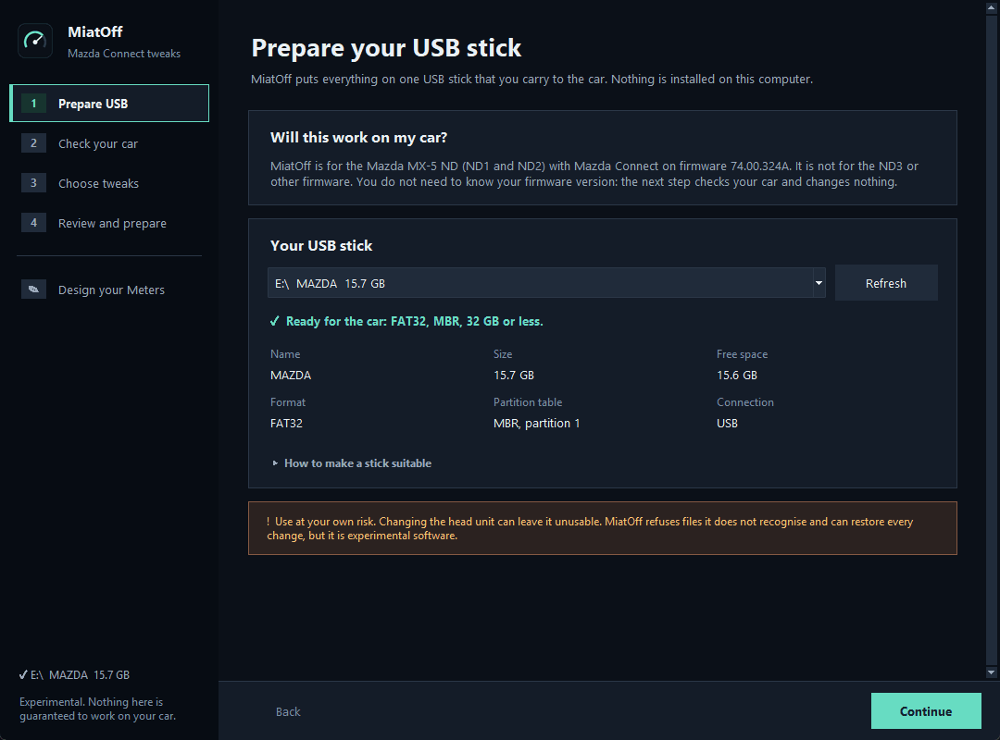
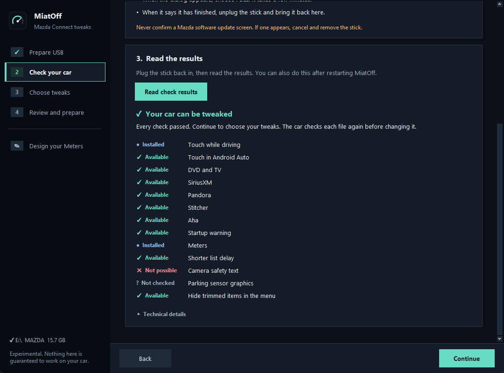
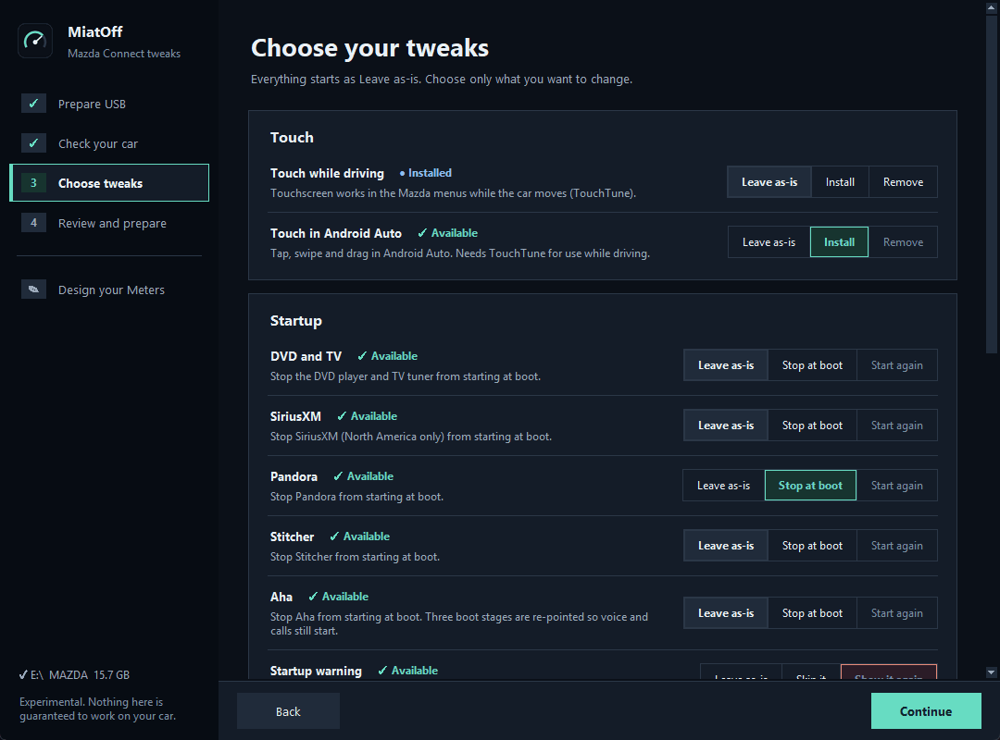

# MiatOff

Open-source tweaks for the Mazda Connect infotainment in the **Mazda MX-5 (ND)**. You build a USB stick on your PC,
plug it into the car, and choose what to install. Every change can be undone, and the tool checks your car first and
refuses to touch anything it does not recognise.

> **Who this is for:** the **MX-5 ND1 and ND2** with the original Mazda Connect head unit on firmware **74.00.324A**
> (check *Settings → System → About → Version Information*). It is **not** for the **ND3** (2024 and later, a different
> head unit) or for any other firmware version. The tools check the car first and refuse to change anything else.

> ⚠️ **Early release.** Modifying a head unit can leave it unusable and is not covered by Mazda's warranty. You use this at
> your own risk. Read [Is it safe?](#is-it-safe) and the [support status](#support-status) first.

## What you can do

| Tweak | What it does |
|---|---|
| **Touch while driving** | The touchscreen keeps working in the Mazda menus while the car moves (uses TouchTune). |
| **Touch in Android Auto** | Tap, swipe and drag in Android Auto (uses the oem-aa-mod touch shim). |
| **Boot trim** | Stops things you don't use from starting at boot, each on its own: DVD/TV, SiriusXM, Pandora, Stitcher, Aha. |
| **Hide trimmed items in the menu** | Also hides the sources you stopped at boot in the Entertainment menu (one item for all; untested by us). |
| **Startup warning** | Skips the warning screen at startup. |
| **Shorter list delay** | Lists scroll sooner and faster when you hold the Commander tilted. |
| **Camera safety text** | Blanks the safety text over the reversing camera picture (untested by us). |
| **Parking sensor graphics** | Makes the on-screen parking sensor graphics semi-transparent (needs a reversing camera view; untested by us). |
| **Shorter list delay** | Holding the Commander tilted starts scrolling a list after 0.15 s instead of 1.5 s (after MZD-AIO). |
| **Parking sensor graphics** | Semi-transparent parking sensor graphics over the camera picture (MZD-AIO's images); the originals stay on the unit. |
| **Camera safety text** | Blanks the safety text over the reversing camera picture (MZD-AIO's blank image); the originals stay on the unit. |
| **Meters** | Gauges under *Applications*: speed, rpm, G-meter, lap timer, fed by the car's own data. No OBD adapter needed. |
| **Meters Designer** | Design your own Meters pages on the PC. Up to eight show in the car under *Applications → Meters → CUSTOM*. |

You choose per tweak: **Install**, **Remove** or **Leave as-is**. The tool never changes anything you did not pick.

## Support status

Only one car has been analysed in depth (a 2017 EU ND1, plain `sm.conf`). Everything below was tested on it unless a row says otherwise.

| Firmware | Car | Feature | Status |
|---|---|---|---|
| 74.00.324A | EU MX-5 ND1 | Check my car (read-only dump) | Tested in the car |
| 74.00.324A | EU MX-5 ND1 | Touch in Android Auto, boot trim, startup warning | Experimental: installed and running on our car (also on the simulator) |
| 74.00.324A | EU MX-5 ND1 with wireless CarPlay (`sm_WCP.conf`) | Touch in Android Auto, boot trim | Experimental: same edits on `sm_WCP.conf`; tested on a simulator and by a contributor on an ND2 (below), not on our own car (it uses `sm.conf`) |
| 74.00.324A | EU MX-5 ND1 | Meters | Experimental: installed on our car; an earlier in-car failure (busy root remount) was fixed |
| 74.00.324A | EU MX-5 ND1 | Meters Designer pages (CUSTOM) | Experimental: installed and used on our car with three simple pages; known issues in [docs/15](docs/15-meters-designer.md#known-issues) |
| 74.00.324A | EU MX-5 ND1 | Shorter list delay | Experimental: ran on our car without problems; the effect is only visible when scrolling lists |
| 74.00.324A | EU MX-5 ND1 | Blank reversing-camera safety text | Experimental: simulator and the contributor's unit only; **not tested by us** (no camera) |
| 74.00.324A | EU MX-5 ND1 | Semi-transparent parking sensor graphics | Experimental: all 44 image hashes match our unit; no visible effect on a car without a reversing camera (our car only beeps), so **not tested by us** |
| 74.00.324A | US-spec MX-5 ND1 | Not specified | Reported working by a user; not verified by us |
| 74.00.324A | EU MX-5 ND2 (RF, 2.0, 2022) with wireless CarPlay (`sm_WCP.conf`) | Check, install and the `sm_WCP.conf` edits | **Reported working by a contributor** who ran it on their own car. Android Auto showed up but was not tried |
| 74.00.324A | other MX-5 ND2 | everything | Same software as far as we know, but not analysed by us: run the check first |
| anything else | any | everything | Unsupported: the tools refuse to change anything |

Stay on firmware **74.00.324A** and do **not** upgrade to 74.00.331: it breaks wireless CarPlay more often and cannot be
rolled back. Check yours under *Settings → System → About → Version Information*.

Another car or firmware? Run the check (below) and open an issue with only `SUMMARY.txt` from the dump. See
[CONTRIBUTING.md](CONTRIBUTING.md).

## What you need

- A **Windows, macOS or Linux PC**. Download the app from [Releases](https://github.com/CeyssensHelder/MiatOff/releases)
  (when a preview is published): no Python or other tools needed, and it works offline. **Windows** is what we use.
  The macOS and Linux downloads are untested so far. See [Opening the app](#opening-the-app).
- An **empty USB stick**, 32 GB or smaller, formatted **FAT32** with an **MBR** partition table.
- An **MX-5 ND1 or ND2** with Mazda Connect on firmware 74.00.324A (see the support status above). We analysed a 2017 EU
  ND1; a US-spec ND1 has been reported working. **Not** the ND3, and no other firmware.

## How to use it

Open MiatOff. The list on the left is the whole journey; **Back** and **Continue** are at the bottom.

1. **Prepare USB:** plug in your stick. MiatOff says whether the car can read it, and how to fix it if not. It never
   formats a drive.

   
2. **Check your car:** press **Make check stick**, put the stick in the car (engine on, home screen showing) and choose
   **FULL**. It only reads; it changes nothing. Bring the stick back and press **Read check results**. You get a plain answer
   per tweak: *Available*, *Installed*, *Not possible* or *Not checked*. The file-by-file report is under **Technical details**.

   
3. **Choose tweaks:** every tweak starts at *Leave as-is*. Pick what you want to change. Anything the car cannot take stays
   greyed out.

   
4. **Review and prepare:** check the list and press **Prepare USB**. When you see **USB ready**, eject the stick safely.
5. **In the car:** engine on, wait for the home screen, plug the stick into the USB hub. A dialog offers your next step with
   **INSTALL** (or **REMOVE**) and **CANCEL**. Each step restarts the unit; leave the stick in and the next step appears
   once the screen is back. When everything is done you see "Your plan is complete".

For a first try, choose **CANCEL** at the first dialog: nothing changes, but you get a log and a state file on the stick
that show the unit is recognised.

> Never confirm a Mazda *software update* screen. If one appears, cancel and remove the stick.

### Your own Meters pages

1. In the app, open **Design your Meters** and press **Open designer**. It opens in your web browser on this PC.
2. Design your pages and press **Send to builder**. Back in the builder, tick up to eight pages.
3. Under **Choose tweaks**, set Meters to *Install* (or *Update* if it is already on the car) and prepare the stick.
4. In the car, accept the step (**INSTALL**, or **REPAIR** for an update). The pages are under *Applications → Meters → CUSTOM*.

To change them later, repeat from step 2. Start with one simple page. More in [docs/15](docs/15-meters-designer.md).

### Opening the app

The downloads are previews and are not signed yet, so your computer warns you the first time. Only open a file you
downloaded from this project's Releases page; `SHA256SUMS.txt` there lists the checksum of each download.

- **Windows:** if SmartScreen says it protected your PC, choose **More info**, then **Run anyway**.
- **macOS:** open the app once and let it be refused. Then go to **System Settings > Privacy & Security**, press **Open Anyway**
  next to MiatOff and confirm.
- **Linux:** unpack the archive and run `MiatOff` inside the folder.

There is no need to turn off your computer's security settings.

To run from source instead (for developers): install Python 3 with Tk, clone this repository and run `python miatoff_gui.py`.

### Going back

- Choose **Remove** for the tweak and build a new stick; every change is restored byte for byte.
- If the Mazda menu misbehaves after Meters or the startup-warning tweak: put an empty file named `MIATOFF-RESTORE`
  in the root of the stick and plug it in. It puts those two back without any dialog.
- Last resort: reflash the official EU 74.00.324A firmware.

Details per stick, including exactly which files change on the car: [aa-touch-stick/README.md](aa-touch-stick/README.md).

## Is it safe?

MiatOff changes the **head unit only**. It never touches the engine computer or the CAN bus, and it needs no OBD adapter.

- **It refuses anything unknown.** Every file is recognised by its exact sha256, as stock or as already patched. A different
  firmware, a modified file or an unknown state: nothing is changed, and the state is written to the stick.
- **No half-installed state.** Each file is staged, verified and swapped in with one atomic rename, in an order where
  every in-between state still boots. A power cut or a failure is rolled back or finished by the next run.
- **Backups and byte-exact removal.** Stock copies are kept on the unit and removal restores them exactly.
- **No boot loops from the Android Auto shim.** A crash can at most switch Android Auto off, not restart the whole unit.
- **Tested without a car:** a simulator replays installs, removals, power cuts and failures under BusyBox, including against
  the real stock files. What it cannot cover is the real unit, so **start with the dry run** described above.

Touch while driving removes a deliberate distraction limit. Follow your local law and keep your eyes on the road.

## Troubleshooting

- **Nothing happens when I plug the stick in.** Look for `miatoff-aa-touch.log` (or `miatoff-dump.log`) on the stick. If it
  is missing the script did not start: check FAT32 + MBR, that only one such stick is plugged in, and that the home screen
  was showing.
- **"This unit differs from the analysed state."** The firmware or a file is not the known one. Nothing was changed. Run
  the check and see the report.
- **The dialog comes back every time I start the car.** The stick is still plugged in. Remove it.

## Documentation

| For | Where |
|---|---|
| Exactly what each stick does on the car | [aa-touch-stick/README.md](aa-touch-stick/README.md), [dump-stick/README.md](dump-stick/README.md) |
| The Meters gauges and their data | [meters/README.md](meters/README.md), [meters-app/README.md](meters-app/README.md), [collector/README.md](collector/README.md) |
| How the head unit works, research and design notes | [docs/README.md](docs/README.md) |
| What we plan to do next | [TODO.md](TODO.md) |

## Contributing

Bug reports, new-firmware reports and pull requests are welcome. Read [CONTRIBUTING.md](CONTRIBUTING.md) first. Never
upload a firmware dump; it contains copyrighted Mazda files and personal data.

### Developing with an AI assistant

If you use an AI coding assistant, point it at [`AGENTS.md`](AGENTS.md) first: it explains the layout, the safety rules
and how to run the tests. Background and open questions are in [`docs/ai/`](docs/ai/).

## Credits and thanks

MiatOff stands on the work of the Mazda Connect modding community. Thank you to:

- **Miatafy** for **[TouchTune](https://github.com/Miatafy/TouchTune)**, the free, open-source (GPL-3.0) touch-while-driving
  tool. MiatOff ships TouchTune 1.2.1 unmodified, uses its launcher mechanism and its install/verify/rollback approach as
  the blueprint for everything else, and hands over to it for the touch-while-driving step.
- **Vitaliy Kurokhtin** for **[oem-aa-mod](https://github.com/VitaliyKurokhtin/oem-aa-mod)** (AGPL-3.0), the Android Auto touch shim.
- **Trevor G Martin (Trevelopment)** for **[MZD-AIO](https://github.com/Trevelopment/MZD-AIO)** and MZD_Speedometer, which
  TouchTune and the Meters menu integration build on.
- **jmgao** ([mazda-connector](https://github.com/jmgao/mazda-connector)) for the safe boot-hook pattern, **junoh-moon**
  ([mazda-aa-dr](https://github.com/junoh-moon/mazda-aa-dr)) for hard-won warnings about the vehicle data service, and
  **silverchris** ([Mazda CMU documentation](https://silverchris.github.io/mazda-cmu-documentation/)) for the boot and recovery notes.
- The security researchers at ZDI/Trend Micro whose public work documents how the unit boots.
- The **Chakra Petch**, **Share Tech Mono**, **Rajdhani** and **Russo One** fonts (SIL Open Font License).

See [NOTICE](NOTICE) for the exact licences. MiatOff is not affiliated with or endorsed by Mazda. It contains no Mazda files;
the scripts only hold the hashes of the stock files they expect.

## Licence

MiatOff is GPL-3.0-or-later; see [LICENSE](LICENSE). Because it builds on GPL-3.0 and AGPL-3.0 work, anyone who
redistributes it must keep the notices in [NOTICE](NOTICE) and provide the source.
